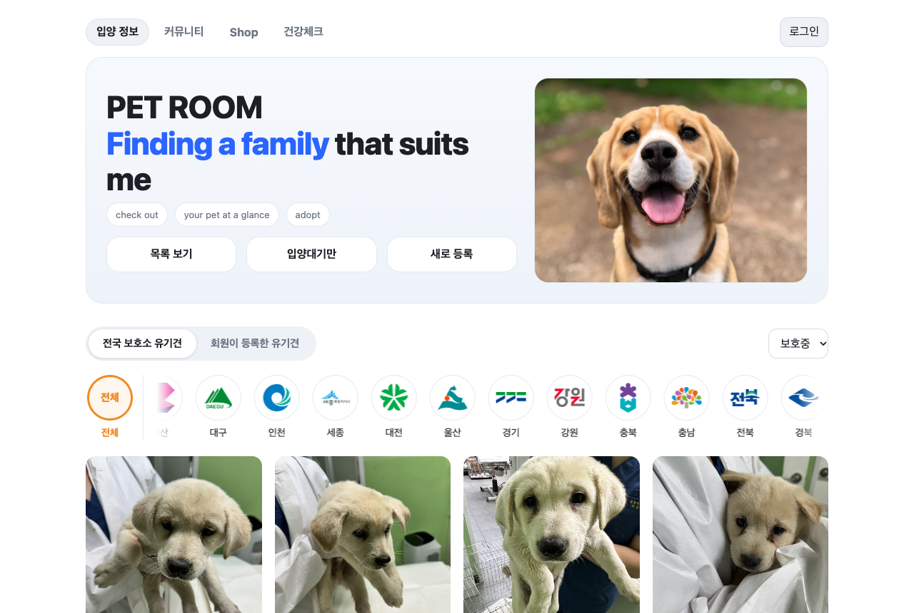
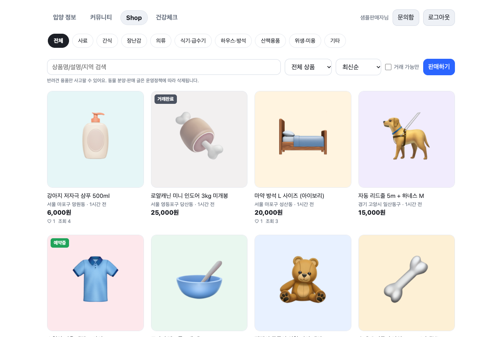
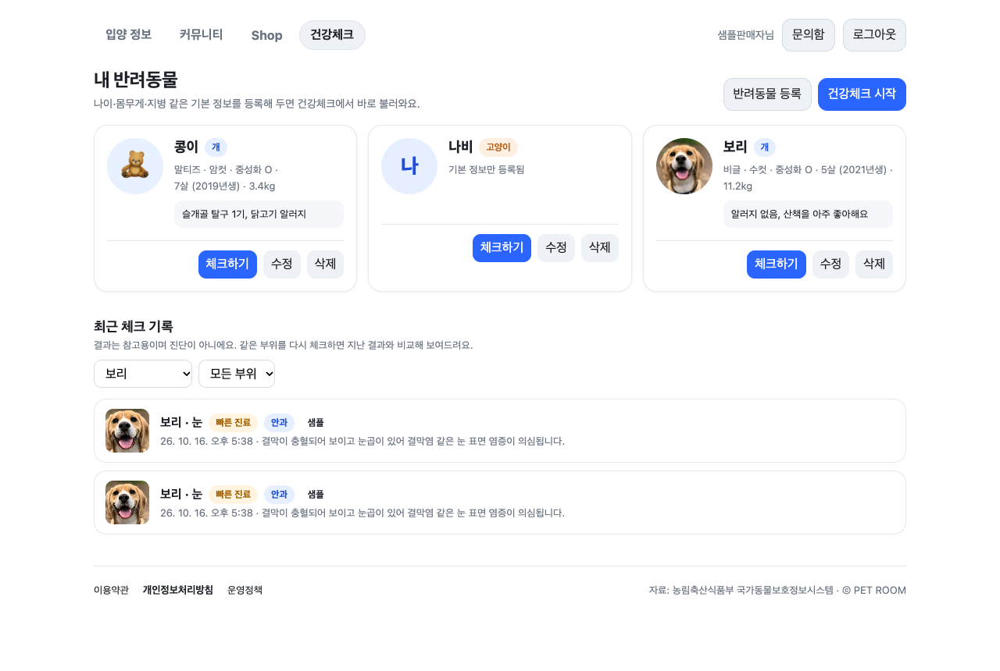
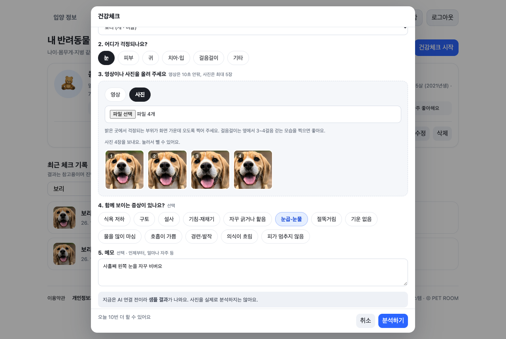
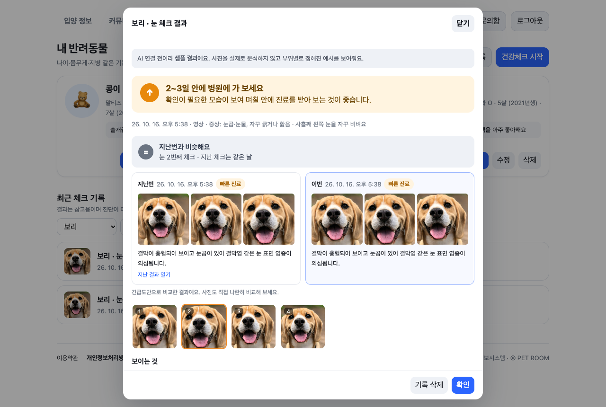
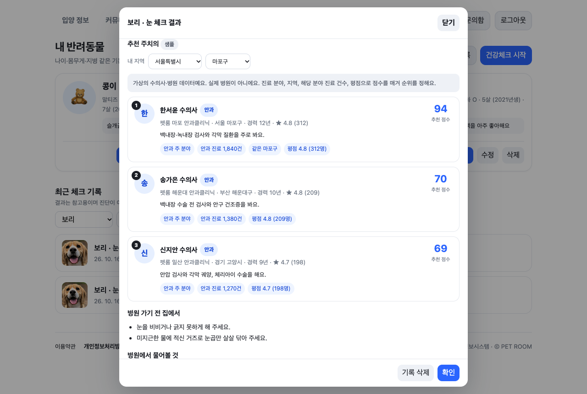
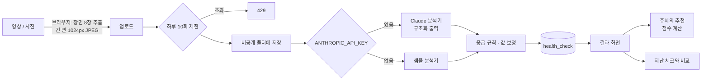
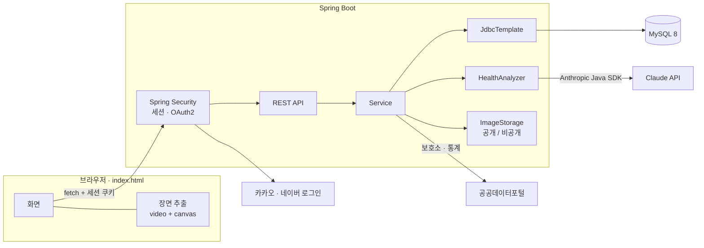

# PET ROOM

유기견 입양 정보를 나누고, 입양한 뒤에는 용품을 사고팔며, 반려동물이 아플 때 **병원에 가기 전 사진·영상으로 상태를 가늠해 보는** 반려동물 서비스입니다.

- **입양 정보**: 공공데이터(국가동물보호정보시스템)로 전국 보호소의 실제 유기견과 통계를 보여주고, 회원이 직접 유기견을 등록할 수 있습니다
- **커뮤니티 · Shop**: 입양 후기와 정보를 나누고, 반려견 용품을 회원끼리 중고거래합니다
- **건강체크**: 반려동물의 영상이나 사진을 올리면 AI(Claude)가 긴급도·소견·진료 분야를 판단하고, 분야에 맞는 주치의를 추천합니다. 같은 부위를 다시 체크하면 지난 결과와 비교합니다

> 건강체크 결과는 참고용이며 수의사의 진단을 대신하지 않습니다. 주치의 추천에 쓰는 수의사·병원은 시연용 가상 데이터입니다.

---

## 주요 화면

| 입양 정보 | Shop |
|---|---|
|  |  |
| **건강체크: 내 반려동물과 체크 기록** | **건강체크: 체크하기** |
|  |  |
| **결과: 긴급도와 지난 체크 비교** | **결과: 추천 주치의** |
|  |  |

---

## 주요 기능

### 입양 정보
- **전국 보호소 유기견**: 공공데이터포털 API로 전국 보호소의 유기견을 지역(시도)·상태(보호중/공고중)별로 조회. 사진 카드, 상세 정보(공고번호, 특징, 보호소 연락처), 최근 30일 통계(구조 수, 입양률, 안락사율)와 상세 통계
- **회원이 등록한 유기견**: 등록·수정·삭제(작성자 본인만), 여러 장 사진 업로드, 검색·필터·정렬, 상태별·품종별 통계 차트, 입양 문의
- **AI 기능 (OpenAI)**: 입양 홍보 문구 생성, 조건 기반 입양 추천 (사용자가 입력한 키를 브라우저에 저장해 사용하는 데모 방식)

### 회원 · 안전
- 이메일 회원가입 / 로그인 (세션 방식, 비밀번호 BCrypt), 카카오·네이버 로그인 (OAuth2)
- 약관·개인정보 동의, 내 정보, 회원 탈퇴 (등록한 유기견·상품·반려동물과 사진, 문의, 건강체크 기록 삭제. 커뮤니티 글·댓글은 "탈퇴한 회원"으로 남김)
- 신고: 서로 다른 회원 3명이 신고하면 자동 숨김 (작성자 본인에게만 보임)

### 커뮤니티 게시판
- 말머리(자유, 정보공유, 입양후기, 질문, 실종·목격), 사진 최대 5장, 검색, 페이지, 조회수
- 댓글과 대댓글(2단계), 작성자만 수정·삭제

### Shop (반려견 용품 중고거래)
- 사료·간식·장난감·의류·식기 등 9개 카테고리, 가격 0원은 "나눔"
- 검색, 거래 가능만 보기, 정렬(최신·인기·가격), 관심 목록, 내 판매 상품
- 거래 상태(판매중 / 예약중 / 거래완료), 관심(찜), 구매 문의 → 판매자가 문의함에서 답변
- 동물 분양·판매는 금지 (운영정책·화면 안내)

### 건강체크
| 단계 | 내용 |
|---|---|
| 내 반려동물 | 이름·종류·품종·성별·중성화·태어난 해·몸무게·특이사항·사진. 1인 최대 10마리 |
| 체크하기 | 반려동물 → 부위(눈·피부·귀·치아·입·걸음걸이·기타) → 영상 또는 사진 → 증상 체크리스트 → 메모 |
| 결과 | 긴급도(바로 병원 / 빠른 진료 / 지켜보기)와 이유, 근거 장면, 소견, 의심 원인, 추천 진료 분야, 집에서 할 일, 병원에서 물어볼 것 |
| 추천 주치의 | 진료 분야·내 지역·긴급도로 상위 3명과 추천 이유·점수 |
| 지난 체크와 비교 | 같은 반려동물·같은 부위의 바로 이전 체크와 나란히, "나아졌어요 / 비슷해요 / 더 급해졌어요" |

---

## 건강체크 설계

### 흐름



### 시스템 구조



### 기술적으로 고민한 점

**1. 영상은 브라우저에서 장면으로 바꿔서 보낸다**
영상을 서버에 그대로 올리면 용량이 크고, 서버에 ffmpeg 같은 도구가 필요합니다. 브라우저에서 `<video>`를 원하는 시점으로 옮겨 가며 `canvas`로 고르게 8장을 뽑고, 사진과 함께 긴 변 1024px JPEG로 줄여서 올립니다. AI 이미지 입력은 해상도에 비례해 비용이 들어서, 이 단계가 업로드 시간과 AI 비용을 함께 줄입니다. 흐린 장면은 보호자가 눌러서 뺄 수 있습니다.

**2. AI 결과는 형식을 강제하고, 서버가 한 번 더 검사한다**
Claude에는 `장면 N` 라벨과 사진을 번갈아 보내고, 마지막에 반려동물 정보와 증상을 붙입니다. 결과는 Java 레코드에서 자동으로 만든 JSON 스키마로 **구조화 출력**을 받아 글을 파싱하지 않습니다. 그 뒤 서버가 다음을 다시 적용합니다.
- 응급 증상(호흡 곤란, 경련, 의식 저하, 멈추지 않는 출혈)이 있으면 AI 결과와 상관없이 "바로 병원"
- 형식에 맞지 않는 긴급도·진료 분야는 안전한 값(빠른 진료, 일반)으로, 존재하지 않는 장면 번호는 버림
- 프롬프트 규칙: 사진에 보이는 것만 근거로, 병명 단정 금지, 애매하면 더 급한 쪽, 흐린 사진은 다시 찍는 방법 안내, 약 지시 금지

**3. 키가 없어도 끝까지 동작한다**
분석기를 `HealthAnalyzer` 인터페이스로 분리하고, `ANTHROPIC_API_KEY`가 있으면 Claude, 없으면 부위별 예시를 돌려주는 샘플 분석기를 씁니다. 화면·저장·추천·비교를 AI 비용 없이 개발하고 시연할 수 있고, 샘플 결과는 화면에 "샘플"로 표시합니다.

**4. 비용 제한은 우회할 수 없게 센다**
하루 10회 제한을 처음에는 "오늘 저장된 기록 수"로 셌는데, 기록을 지우면 횟수가 초기화되는 허점을 테스트 중에 발견했습니다. 지워지지 않는 별도 사용 기록(`health_check_usage`)으로 세도록 바꾸고, 분석을 시작하는 순간 1회를 씁니다(실패해도 AI 호출 비용은 나갈 수 있으므로). AI 호출은 DB 트랜잭션 밖에서 하고, 저장에 실패하면 올린 장면 파일을 지웁니다.

**5. 추천은 AI가 아니라 점수로**
국내에는 아직 수의 전문의 제도가 없어 "분야별로 잘하는 수의사"에 대한 공식 데이터가 없습니다. 그래서 AI는 진료 분야만 정하고, 순위는 아래 점수로 코드가 정합니다. 같은 조건이면 항상 같은 결과가 나오고, 카드마다 점수를 받은 이유를 보여줍니다.

| 항목 | 점수 |
|---|---|
| 진료 분야 | 주 분야 일치 50, 함께 보는 분야 25 |
| 지역 | 같은 시도 10, 같은 시군구 +10 |
| 해당 분야 진료 건수 | 최대 15 |
| 평점 | 최대 10 |
| 응급일 때 24시간 진료 | 5 |

**6. 반려동물 사진은 본인만**
유기견·게시글·Shop 사진은 공개 폴더(`/uploads/`)에, 내 반려동물 사진과 건강체크 장면은 웹으로 서빙되지 않는 비공개 폴더에 저장합니다. 비공개 사진은 본인 확인을 거친 API(`/pets/{id}/image`, `/health-checks/{id}/frames/{n}`)로만 내려주고, 다른 회원에게는 존재 여부도 알리지 않도록 404를 돌려줍니다.

---

## 기술 스택

| 구분 | 사용 기술 |
|---|---|
| Frontend | HTML, CSS, JavaScript (단일 페이지 `src/index.html`), Fetch API, Canvas·Video(장면 추출), Chart.js, Kakao Map SDK |
| Backend | Java 17, Spring Boot 3.5, Spring Web, Spring JDBC (JdbcTemplate), Spring Security, OAuth2 Client |
| AI | Anthropic Java SDK (Claude, 구조화 출력), OpenAI API (입양 홍보 문구·추천, 브라우저) |
| Database | MySQL 8 |
| 외부 API | 공공데이터포털 구조동물 조회 서비스, 카카오/네이버 로그인 |
| Test | JUnit 5, Mockito |
| Build | Gradle |

---

## 테스트

```bash
set -a && . ./.env.local && set +a
./gradlew test
```

DB 없이 도는 단위 테스트 49개와, 앱이 정상적으로 뜨는지 확인하는 테스트 1개(로컬 MySQL 필요)가 있습니다.

| 테스트 | 개수 | 확인하는 것 |
|---|---|---|
| `HealthCheckServiceTest` | 19 | 응급 규칙, 이상한 결과 값 보정, 하루 제한과 사용 기록, 기록을 지워도 제한 유지, 남의 기록·장면 접근 차단, 입력 검증, 저장 실패 시 파일 정리, 지난 체크 비교 |
| `ClaudeHealthAnalyzerTest` | 8 | API를 부르지 않고 실제로 만들어지는 요청 확인(라벨·사진 순서, 스키마, 대체 설정), AI 결과 정리, 키 유무에 따른 분석기 선택 |
| `VetRecommendServiceTest` | 8 | 분야·지역·응급 가산점, 만점 100, 분야가 안 맞으면 제외 |
| `MyPetServiceTest` | 5 | 남의 반려동물·사진 접근 차단, 삭제 시 기록·사진 정리, 10마리 제한, 입력 검증 |
| `SocialUserServiceTest` | 4 | 카카오·네이버 응답에서 프로필 추출 |
| `ImageStorageTest` | 3 | 실제 임시 폴더로 공개/비공개 분리, 폴더 밖 경로 거부, 기존 사진 옮기기 |
| `SampleHealthAnalyzerTest` | 2 | 모든 부위에 대해 정해진 형식의 결과 |
| `DbProjectApplicationTests` | 1 | 앱 기동 |

테스트가 실제로 규칙을 잡는지도 확인했습니다. 서비스 코드에서 응급 규칙을 빼면 테스트 2개가, 사용 기록 남기기를 빼면 1개가 실패합니다.

---

## 한계와 다음 단계

- **실제 Claude 결과 품질과 비용은 아직 측정 전입니다.** 개발은 샘플 분석기와 가짜 키(인증 실패 처리 확인)로 했습니다. 실제 키로 결과를 확인하고, AI Hub 반려동물 피부·안구 질환 데이터로 정확도를 측정해 이 문서에 표로 추가할 예정입니다.
- **주치의는 가상 데이터입니다.** 실제 동물병원 위치는 행정안전부 동물병원 조회서비스(공공데이터)로 붙일 예정이며, 실제 병원에는 전문 분야를 표시하지 않고 위치만 보여줄 계획입니다.
- **실제 휴대폰 영상은 검증 전입니다.** 페이지에서 녹화한 webm 영상으로 테스트했고, 아이폰 HEVC(.mov)처럼 브라우저가 열지 못하는 형식은 사진으로 올리도록 안내합니다.
- 비공개 사진은 로그인 쿠키로 확인하므로, 배포 시 프론트와 백엔드를 같은 사이트(같은 도메인·하위 도메인) 아래에 두어야 합니다.
- 프론트엔드가 단일 HTML 파일(약 2,800줄)이라, 기능이 더 늘어나면 모듈 분리가 필요합니다.

---

## 로컬에서 실행하기

### 1. 준비물
- **JDK 17** (`build.gradle`이 Java 17 툴체인을 사용합니다. JDK 21만 있으면 빌드가 실패하니 17을 설치하세요)
- **Docker** (MySQL 실행용)
- **Python 3** 또는 아무 정적 파일 서버 (프론트 실행용)

### 2. MySQL 실행
비밀번호는 원하는 값으로 바꾸고, 아래 3번의 `DB_PASSWORD`에 같은 값을 넣으세요.

```bash
docker run -d --name petroom-mysql \
  -p 127.0.0.1:3307:3306 \
  -e MYSQL_ROOT_PASSWORD=원하는비밀번호 \
  -e MYSQL_DATABASE=petdb \
  -e TZ=Asia/Seoul \
  mysql:8.0 --character-set-server=utf8mb4 --collation-server=utf8mb4_unicode_ci
```

테이블은 서버가 처음 뜰 때 `src/main/resources/schema.sql`로 자동 생성됩니다.

### 3. 환경변수 설정
```bash
cp .env.example .env.local
```
`.env.local`을 열어 값을 채웁니다. 이 파일은 `.gitignore`에 등록돼 있어 커밋되지 않습니다.

| 변수 | 필수 | 설명 |
|---|---|---|
| `DB_USERNAME`, `DB_PASSWORD` | 필수 | MySQL 계정 (위 Docker 기준 `root` / 정한 비밀번호) |
| `KAKAO_CLIENT_ID`, `KAKAO_CLIENT_SECRET` | 선택 | 카카오 REST API 키, 클라이언트 시크릿 |
| `NAVER_CLIENT_ID`, `NAVER_CLIENT_SECRET` | 선택 | 네이버 애플리케이션 Client ID / Secret |
| `ANTHROPIC_API_KEY` | 선택 | 건강체크 AI 분석용 Claude API 키. 비워 두면 샘플 결과만 나옵니다. 사용한 만큼 과금되니 [Anthropic 콘솔](https://console.anthropic.com)에서 월 사용 한도를 걸어 두세요 |
| `HEALTH_AI_MODEL`, `HEALTH_DAILY_LIMIT` | 선택 | 건강체크 모델(기본 `claude-opus-5-5`), 회원당 하루 횟수(기본 10) |
| `ANIMAL_API_KEY` | 선택 | 공공데이터포털 "국가동물보호정보시스템 구조동물 조회 서비스" 인증키 (Decoding) |
| `DB_URL`, `UPLOAD_DIR`, `PRIVATE_UPLOAD_DIR`, `FRONTEND_URL` | 선택 | 기본값 대신 다른 DB, 공개·비공개 업로드 폴더, 프론트 주소를 쓸 때 |

선택 항목을 비워 두면 해당 기능만 꺼집니다. (소셜 로그인 버튼은 안내 문구만, 전국 보호소 영역은 안내 문구만 표시)

### 4. 백엔드 실행 (포트 8081)
```bash
set -a && . ./.env.local && set +a
./gradlew bootRun
```

### 5. 프론트 실행 (포트 5500)
다른 터미널에서:
```bash
cd src
python3 -m http.server 5500 --bind 127.0.0.1
```

### 6. 접속
http://localhost:5500/index.html

업로드한 사진은 두 폴더에 나눠 저장됩니다(둘 다 커밋되지 않음).
- `uploads/`: 유기견·커뮤니티·Shop 사진. `/uploads/파일명`으로 누구나 볼 수 있습니다
- `private-uploads/`: 내 반려동물 사진과 건강체크 장면. 공개 주소가 없고, 로그인한 본인만 `/pets/{id}/image`, `/health-checks/{id}/frames/{n}`으로 받을 수 있습니다. 예전에 `uploads/`에 저장된 반려동물·건강체크 사진은 서버를 시작할 때 자동으로 옮겨집니다

### 소셜 로그인 키를 직접 발급받을 때
각 개발자 콘솔에 아래 주소를 등록해야 합니다.

| 제공자 | 등록 위치 | 주소 |
|---|---|---|
| 카카오 | 앱 설정 > 플랫폼 키 > REST API 키 > 카카오 로그인 리다이렉트 URI | `http://localhost:8081/login/oauth2/code/kakao` |
| 네이버 | API 설정 > 로그인 오픈 API 서비스 환경 > PC 웹 | 서비스 URL `http://localhost:5500`, Callback URL `http://localhost:8081/login/oauth2/code/naver` |

- 카카오: 카카오 로그인 활성화, 동의항목에서 닉네임 설정, 클라이언트 시크릿 활성화가 필요합니다.
- 네이버: 검수 전("개발 중")에는 앱 등록자와 멤버관리에 추가한 계정만 로그인할 수 있습니다.

---

## API 요약

| 구분 | 메서드 | 경로 | 로그인 |
|---|---|---|---|
| 인증 | POST | `/auth/signup`, `/auth/login`, `/auth/logout` | - |
| 인증 | GET | `/auth/me` (로그인 상태 + 사용 가능한 소셜 로그인) | - |
| 소셜 로그인 | GET | `/oauth2/authorization/{kakao\|naver}` | - |
| 회원 등록 유기견 | GET | `/dogs`, `/dogs/{id}`, `/dogs/statistics` | - |
| 회원 등록 유기견 | POST / PUT / DELETE | `/dogs`, `/dogs/{id}` (multipart: `dog` JSON + `images`) | 필요 (수정·삭제는 작성자만) |
| 전국 보호소 유기견 | GET | `/shelter/regions`, `/shelter/animals`, `/shelter/stats` | - |
| 게시판 | GET | `/posts`, `/posts/categories`, `/posts/{id}` | - |
| 게시판 | POST / PUT / DELETE | `/posts`, `/posts/{id}` (multipart: `post` JSON + `images`) | 필요 (수정·삭제는 작성자만) |
| 댓글 | POST / DELETE | `/posts/{id}/comments`, `/posts/{id}/comments/{commentId}` | 필요 |
| Shop | GET | `/shop/meta`, `/shop/items`, `/shop/items/{id}` | - (`filter=liked\|mine`은 필요) |
| Shop | POST / PUT / DELETE | `/shop/items`, `/shop/items/{id}` (multipart: `item` JSON + `images`) | 필요 (수정·삭제는 판매자만) |
| Shop | PUT / POST / DELETE | `/shop/items/{id}/status`, `/shop/items/{id}/like` | 필요 |
| 구매 문의 | POST | `/shop/items/{id}/inquiries` | 필요 |
| 내 반려동물 | GET / POST / PUT / DELETE | `/pets`, `/pets/{id}` (multipart: `pet` JSON + `image`) | 필요 (본인만) |
| 건강체크 | GET | `/health-checks/meta`, `/health-checks?petId=&bodyPart=`, `/health-checks/{id}`, `/health-checks/{id}/compare` | 필요 (본인만) |
| 건강체크 | POST / DELETE | `/health-checks` (multipart: `check` JSON + `frames`), `/health-checks/{id}` | 필요 (본인만) |
| 주치의 추천 | GET | `/vets/recommend?specialty=&sido=&sigungu=&urgency=`, `/vets/regions` | - |
| 구매 문의 | GET / POST | `/inquiries/shop/received`, `/inquiries/shop/sent`, `/inquiries/shop/{id}/reply` | 필요 |

---

## 프로젝트 구조

```
src/
├── index.html                      # 프론트엔드 (단일 페이지)
├── img/regions/                    # 시도 상징 마크
├── main/
│   ├── java/org/likelion/hsu/db_project/
│   │   ├── Config/                 # Security, CORS, 소셜 로그인, 정적 파일, DB 보정, 분석기 선택, 샘플 수의사, 비공개 사진 이동
│   │   ├── Controller/             # Auth, Dog, Post, Shelter, Shop, Inquiry, Report, User, MyPet, HealthCheck, Vet
│   │   ├── Service/                # 비즈니스 로직, 이미지 저장(공개/비공개), 공공데이터 연동,
│   │   │                           #   건강체크 분석기(샘플 / Claude), 주치의 추천 점수
│   │   ├── Repository/             # JdbcTemplate 기반 DB 접근
│   │   └── Entity/  Dto/  Security/
│   └── resources/
│       ├── application.properties
│       └── schema.sql              # 테이블 정의 (기동 시 자동 생성)
└── test/java/...                   # JUnit 5 + Mockito 단위 테스트
docs/images/                        # README 스크린샷
```

---

## 협업 규칙

- `main`은 PR로만 합칩니다(보호 규칙 설정됨). 기능별 브랜치(`feature/...`)를 만들어 PR을 올려 주세요.
- API 키, 비밀번호는 `.env.local`에만 둡니다. 코드, 이슈, PR, 메신저에 붙여 넣지 마세요.
- 공공데이터 자료를 화면에 쓸 때는 출처(농림축산식품부 국가동물보호정보시스템)를 표기합니다.

---

## 담당 역할

이 프로젝트에서 저는 프론트엔드 파트를 담당했습니다.

### 화면 UI 구현

- PET ROOM 메인 화면 구성
- 유기견 목록 카드 UI 구현
- 검색, 필터, 정렬 툴바 구현
- 등록/수정 모달 UI 구현
- 상세 조회 모달 및 이미지 갤러리 UI 구현
- 반응형 레이아웃 적용

### API 연동

- `fetch` 기반 REST API 연동
- 유기견 목록 조회 API 연동
- 유기견 상세 조회 API 연동
- 유기견 등록, 수정, 삭제 API 연동
- 통계 조회 API 연동
- FormData를 활용한 이미지 업로드 요청 처리

### 데이터 시각화

- Chart.js를 활용한 상태별 유기견 현황 그래프 구현
- Chart.js를 활용한 품종별 유기견 현황 그래프 구현
- 데이터 변경 후 차트 자동 갱신 처리

### 사용자 경험 개선

- 이미지 미리보기 기능 구현
- 상세 이미지 갤러리 및 썸네일 전환 기능 구현
- 삭제 전 확인 메시지 처리
- 등록, 수정, 삭제 후 Toast 메시지 출력
- 검색/필터 변경 시 즉시 목록 갱신
- 이미지 캐싱 문제를 줄이기 위한 쿼리 파라미터 처리

### AI 기능 연동

- OpenAI API를 활용한 입양 홍보 문구 생성 기능 구현
- 사용자 조건 기반 AI 추천 기능 구현
- 추천 결과와 추천 이유를 카드 형태로 표시
- API Key를 localStorage에 저장하여 데모 환경에서 활용 가능하도록 처리
